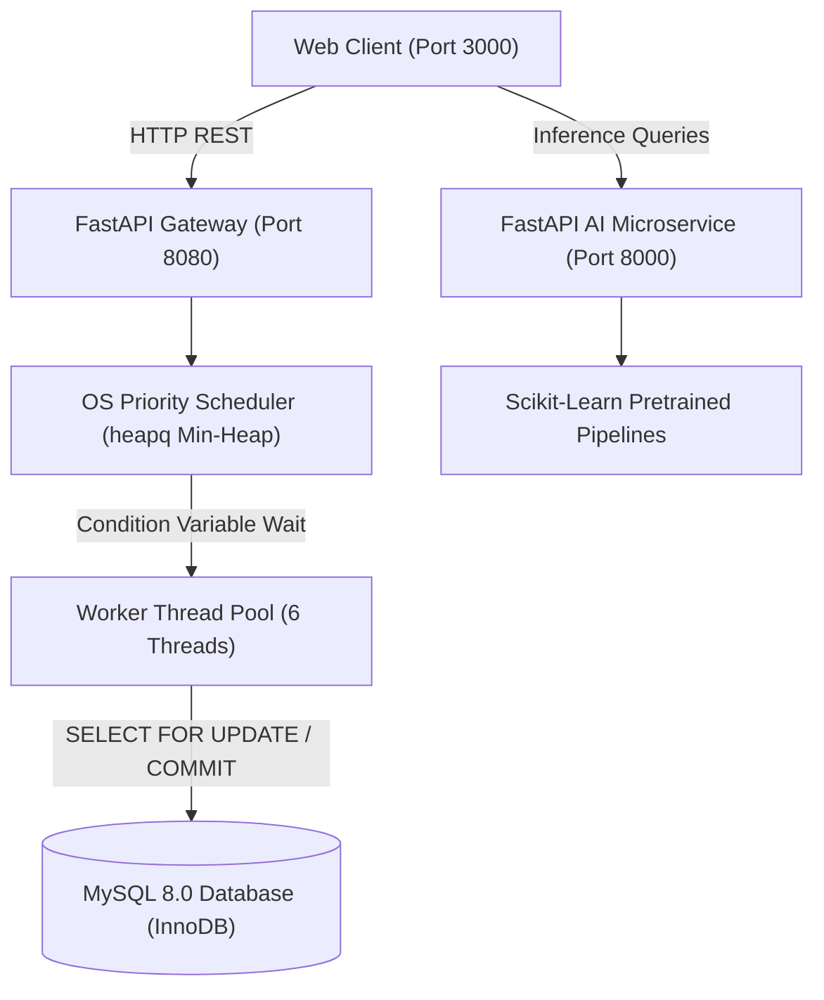

# SmartRail AI+ — Academic Project Documentation

## Academic Project Details
- **Project Title:** SmartRail AI+ — Smart Railway Reservation & Resource Scheduler with AI-Based Prediction and Recommendation
- **Domain:** Operating Systems, Database Management Systems, Artificial Intelligence
- **University:** Graphic Era (Deemed to be University), Dehradun
- **Session:** 2026–2027 (5th Semester)
- **Team ID:** OSDBMS-V-2026-T281
- **Project Mentor:** Dr. Deepak Gaur
- **Team Members:**
  1. **Nishant Kumar** (Team Lead & Developer)
  2. **Robert Sandi Thomas** (Developer & Tester)

---

## 1. Problem Statement
Traditional railway reservation systems face massive concurrent request volumes during peak booking windows (e.g., Tatkal hours). System bottlenecks frequently arise from inefficient database lock contention, unbounded request queuing, lack of transparent priority dispatching, and absence of intelligent predictive decision-support for waitlisted passengers.

---

## 2. Objectives
1. Design and construct a concurrent reservation engine demonstrating multithreading, priority request scheduling, and condition-variable synchronization.
2. Formulate a 3NF relational database schema utilizing MySQL 8.0 InnoDB with row-level locking (`SELECT ... FOR UPDATE`) to guarantee ACID transaction integrity.
3. Train, validate, and integrate Machine Learning models to predict waitlist confirmation probabilities and provide multi-factor train recommendations.
4. Deliver a fully working responsive dashboard with live telemetry monitoring.

---

## 3. System Architecture Diagram

---

## 4. Operating System Concepts in Depth

### 4.1 Multithreading & Thread Pool
The reservation engine instantiates a pool of 6 worker threads on startup. These threads run daemonized loops, sleeping on condition variables when the task queue is empty and waking immediately when tasks arrive.

### 4.2 Producer-Consumer Pattern
- **Producers:** Web request worker threads handle client HTTP posts and push booking requests into a shared queue.
- **Consumers:** Backend worker threads extract tasks from the queue and execute them inside database transactions.
- **Synchronization:** Coordinated using condition variables (`threading.Condition` / `std::condition_variable`) to prevent CPU-intensive spinning.

### 4.3 Priority Scheduling Hierarchy
1. `EMERGENCY` (Priority 1)
2. `SENIOR_CITIZEN` (Priority 2)
3. `TATKAL` (Priority 3)
4. `NORMAL` (Priority 4)

Deterministic tie-breaking is enforced by comparing:
$$(\text{Priority Level}, \text{Timestamp}, \text{Request UUID})$$

### 4.4 Deadlock Prevention
A single-lock acquisition hierarchy is maintained. Worker threads release queue locks before acquiring database locks, eliminating circular-wait conditions.

---

## 5. DBMS Implementation & ACID Properties
- **Atomicity:** Entire booking or cancellation transactions either commit completely or roll back automatically upon failure.
- **Consistency:** Foreign key constraints and check constraints enforce valid train, coach, and user associations.
- **Isolation:** Row-level locks (`SELECT FOR UPDATE`) on the `seat_inventory` table isolate concurrent booking attempts.
- **Durability:** Committed transactions are flushed to disk via MySQL InnoDB write-ahead redo logging.

---

## 6. AI/ML Algorithms
- **Waitlist Confirmation Predictor:** Trained on synthetic features including WL position, days to journey, quota, and cancellation rates. Logistic Regression achieved an ROC-AUC of 0.6949 and was serialized using Joblib.
- **Train Recommendation Model:** Multi-factor objective function balancing departure timing, user budget tier, seat availability, and journey duration.
- **Seat Allocator:** Priority allocation heuristics prioritizing lower berths for senior citizens.

---

## 7. Results & Limitations
- **Results:** Handled 10 concurrent requests for 2 seats with 100% data consistency (2 confirmed, 8 waitlisted, 0 seat duplicates).
- **Limitations:** All machine learning models operate on synthetic demonstration datasets and must not be used for real railway operations.

---

## 8. Conclusion
SmartRail AI+ successfully bridges theoretical principles from Operating Systems, Database Management Systems, and Artificial Intelligence into a cohesive, demonstrable, and high-performance software engineering project.
