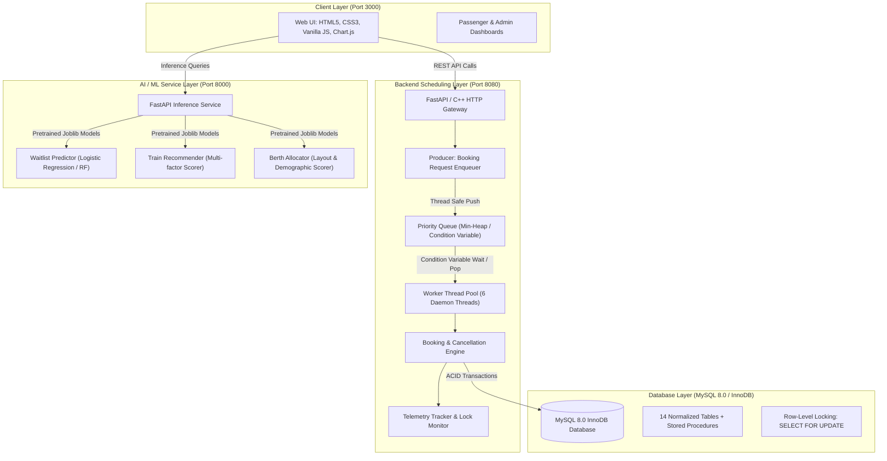

# SmartRail AI+ — Architecture Specification

## Academic Project Information
- **Project Title:** SmartRail AI+ — Smart Railway Reservation & Resource Scheduler with AI-Based Prediction and Recommendation
- **Domain:** Operating Systems, Database Management Systems, Artificial Intelligence
- **University:** Graphic Era (Deemed to be University), Dehradun
- **Academic Session:** 2026–2027 (5th Semester)
- **Team ID:** OSDBMS-V-2026-T281
- **Project Mentor:** Dr. Deepak Gaur
- **Team Members:**
  1. Nishant Kumar (Team Lead & Developer)
  2. Robert Sandi Thomas (Developer & Tester)

---

## 1. High-Level Architectural Diagram

---

## 2. Layer Responsibilities

### Client Presentation Layer
- Built with standard modern web technologies (HTML5, CSS3, responsive Flexbox/Grid, Chart.js).
- Provides dedicated panels for:
  - Train Search & Live Inventory Checking
  - Passenger Detail Entry & PNR Generation
  - Real-time PNR Tracking and Cancellation
  - AI Waitlist Probability Meter
  - AI Train and Seat Recommendations
  - Live OS Telemetry & Worker Inspection
  - System Administrator Transaction Audit Logs

### Core Reservation & OS Scheduling Layer
- Serves as the authoritative engine for booking confirmations, physical seat assignments, and database modifications.
- Implements multithreaded worker pools with strict deadlock prevention and deterministic tie-breaking.
- Protects shared seat inventory from race conditions using transactions with row-level locks.

### AI/ML Prediction Service Layer
- Independent FastAPI microservice providing probabilistic estimations.
- Serves serialized Scikit-Learn pipelines without directly altering database booking states.
