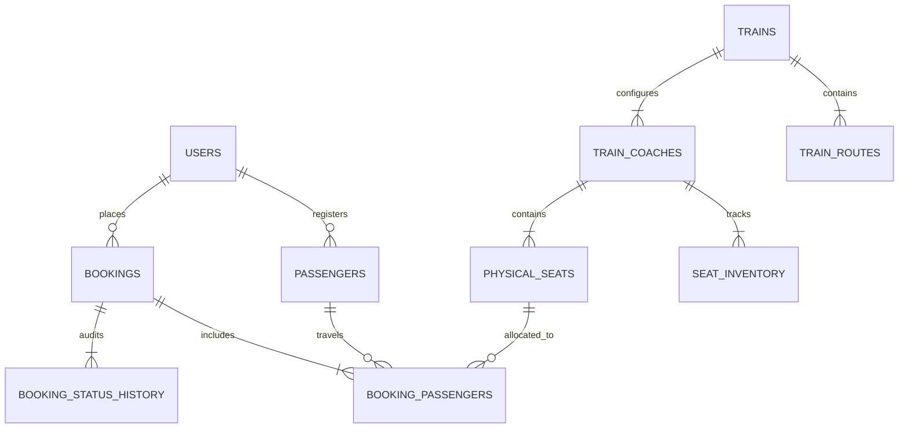

# SmartRail AI+ — Database Design Specification

## Engine & Normalization
- **RDBMS:** MySQL 8.0+
- **Storage Engine:** InnoDB (ACID compliant)
- **Character Set:** `utf8mb4` with `utf8mb4_unicode_ci`

---

## 1. Relational Entity Relationship Model

---

## 2. Table Catalog (14 Tables)

1. **`users`**: User identities, role-based access (`PASSENGER`, `ADMIN`), salted PBKDF2 / bcrypt hashes.
2. **`stations`**: Railway stations with station codes (e.g. `NDLS`, `HWH`), geographical coordinates, and zones.
3. **`trains`**: Train numbers, names, train types (`RAJDHANI`, `SHATABDI`, etc.), schedule departure/arrival.
4. **`train_routes`**: Ordered stop sequences with halt minutes, distances in km, and arrival/departure times.
5. **`train_coaches`**: Coach codes, classes (`1AC`, `2AC`, `3AC`, `SL`, `CC`), total capacity, base fare formulas.
6. **`seat_inventory`**: Per-train, per-coach, per-date available seat counters, confirmed counters, and waitlist counters.
7. **`physical_seats`**: Individual berths (Lower, Middle, Upper, Side Lower, Side Upper) with window indicators.
8. **`passengers`**: Passenger master profile records (name, age, gender, identity document type).
9. **`bookings`**: 10-digit unique PNR header, user ID, status (`CONFIRMED`, `WAITING`, `CANCELLED`), priority level.
10. **`booking_passengers`**: Individual traveler seat allotment, berth allotted, waitlist position, passenger fare.
11. **`booking_status_history`**: Audit trail recording state transitions (e.g. `WAITING` $\rightarrow$ `CONFIRMED` on cancellation).
12. **`db_transactions_log`**: Transaction tracking with UUID, status (`COMMITTED`, `ROLLED_BACK`), duration, rows affected.
13. **`os_scheduling_metrics`**: Telemetry log recording queue wait duration, worker thread ID, processing time.
14. **`ai_prediction_logs`**: Historical inference log storing model inputs, outputs, scores, and confidence ratings.

---

## 3. Concurrency Protection & Transaction Integrity
- **Atomicity:** All booking operations take place within explicit transactions (`START TRANSACTION ... COMMIT / ROLLBACK`).
- **Row-Level Locking:** Seat inventory checks and physical seat lookups utilize `SELECT ... FOR UPDATE` to block concurrent transactions from over-allocating seats.
- **Race Condition Prevention:** Verified by automated concurrency tests ensuring two concurrent requests cannot book the same physical seat.
